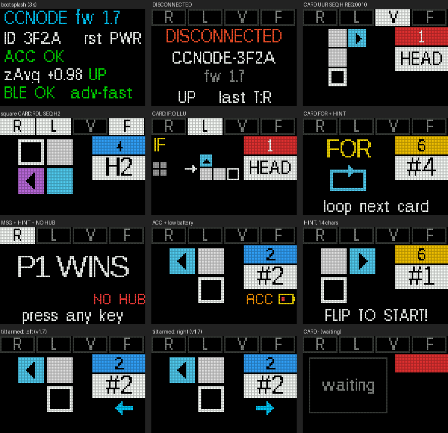

# CCNode: controller node firmware (TinyScreen+)

Firmware for the physical controller nodes of the maze-racing game. Each node is a
**thin I/O device**. It detects flips, tilts, taps and button presses, sends them to the hub as
raw events over BLE, and draws whatever the hub tells it to. It runs no game logic.

> **Firmware 1.7b** lowers the roll angle and hold time for left/right tilts. The board sends the
> direction after it returns to level. See section 5 for the gesture and section 7 for physical
> checks. The startup screen and the hub's BLE node card show `1.7b`.

---

## 1. Files

```
firmware/CCNode/
  CCNode.ino        main loop: modes, splash, HELLO sync, BAT, NO HUB, debug heartbeat
  config.h          ALL tunables + the calibration block
  gestures.*        flip, tilt and tap detection, V-tap counters (pure C++, host-tested)
  protocol.*        hub message parser, line framing, display state (pure C++, host-tested)
  card_layout.*     card path -> grid cells (pure C++, host-tested)
  buttons.h         debounce + bit remapping (pure C++, host-tested)
  accel_core.*      BMA253 driver: non-blocking probe, FIFO, missing/re-probe (pure C++, host-tested)
  soft_i2c.h        bit-banged I2C with timeouts + bus recovery (template, host-tested)
  i2c_bus.*         I2C backend on the board's SDA/SCL pins (soft I2C, or Wire as an option)
  watchdog.h        SAMD21 watchdog (~2 s) and reset-cause readout
  battery.*         battery voltage -> BAT:<percent>
  node_id.*         node ID from the SAMD21 serial number
  display.*         incremental, time-boxed renderer for the 96x64 OLED
  ble_link.*        BLE peripheral, Nordic UART Service (all radio code is here)
  src/STBLE/        TinyCircuits STBLE 0.1.2, bundled with patches (PATCHES.md, LICENSE-ST.txt)
test/               host tests, TinyScreen mock, I2C/BMA253 simulation, screenshots (make -C test)
tools/compile_check.sh   arm-none-eabi compile/link check without the Arduino IDE (SKETCH=<dir> for other sketches)
tools/contact_sheet.py   rebuilds docs/screens.png from the test screenshots
tools/DisplayTest/  minimal display + serial check sketch (rules out board/upload/hardware problems)
CHANGELOG.md        changes per brief version
SPEC_QUERY_1..8.md  Spec Queries sent, in order. SPEC_QUERY_8 = current: status, mock-up, checklist, assumptions.
```

## 2. Hardware, board settings, libraries

| Item | Value |
|---|---|
| Board | TinyCircuits **TinyScreen+** (SAMD21G18A, 48 MHz) |
| BLE | **BLE TinyShield (ST), ASD2116**, BlueNRG-MS / SPBTLE-RF |
| Accelerometer | Accelerometer TinyShield ASD2511 Rev5, **BMA253** at I²C `0x18`, chip ID `0xFA` |
| Battery | LiPo on the TinyScreen+ battery connector, read on A4 through the on-board 1:2 divider |
| Arduino IDE | 1.8.x or 2.x |
| Board package | *Arduino SAMD Boards* (install first), then *TinyCircuits SAMD Boards*. Board manager URL: `http://files.tinycircuits.com/ArduinoBoards/package_tinycircuits_index.json` |
| Libraries | **TinyScreen** 1.1.0 (Library Manager or TinyCircuits GitHub). SPI comes with the board package. **STBLE is bundled in the sketch**; you don't need to install it, and an installed copy is ignored. Wire is not used unless `I2C_USE_WIRE 1`. |

Keep the accelerometer shield's orientation **the same on every node**, because all nodes share one
calibration block.

## 3. Flashing, and the serial monitor

**Arduino IDE settings**
- **Tools → Board → TinyCircuits SAMD Boards → TinyScreen+**. Not "Arduino Zero": that board has a
  different pin map and no display SPI port.
- **Tools → Port:** the TinyScreen+ USB port. On Linux it's `/dev/ttyACM0` (or `ttyACM1`…), on
  macOS `/dev/cu.usbmodem…`, and on Windows `COMn` (the IDE labels it "TinyScreen+").
- **Serial monitor:** **115200** baud (USB serial ignores the value, but use 115200), line ending
  **Newline**.
- **The port can change after uploading.** The board resets into its bootloader to be flashed,
  then reappears, sometimes under a different name (e.g. a new COM number on Windows, `ttyACM1`
  on Linux). After every upload, check Tools → Port again and reopen the serial monitor.

**Steps**
1. Install the board package and the TinyScreen library (table above).
2. Open `firmware/CCNode/CCNode.ino`. The IDE compiles `src/STBLE` automatically.
3. Select the board and port, then Upload.
4. The screen first lists the startup steps, then shows the **boot splash** for ~3 s (firmware, node
   ID, reset cause, ACC status, live `zAvg` and UP/DOWN, BLE state), then **DISCONNECTED** with the
   name `CCNODE-XXXX`. That name is the node's unique ID, derived from the SAMD21 serial number and
   stable across reflashes.

If the port doesn't appear at all, the TinyScreen+ may need its bootloader forced. Follow TinyCircuits'
TinyScreen+ setup/recovery instructions. If the screen stays blank, flash `tools/DisplayTest` first
(section 12).

## 4. Modes

USB serial output always goes to the TinyScreen+'s native USB port (`SerialUSB`, one macro
`NODE_SERIAL` in `CCNode.ino`). The node **never waits** for the serial monitor; open it at any time.

| Mode | How to enter | BLE | USB serial |
|---|---|---|---|
| Normal | default | on | boot trace (`# boot: …`) and boot banner only; still accepts commands |
| Debug | any of: `DEBUG_DEFAULT 1` in `config.h`; set `debugMode = true` in `CCNode.ino`; hold **all 4 buttons** at power-on; hold **all 4 buttons for 2 s** while running (toggles, shows "DEBUG ON/OFF" in the hint line); type `!DEBUG` | on | boot banner, **heartbeat every second**, every tx/rx with timestamps, every spike with its classification, every tilt step (candidate / ARMED / COMMIT / CANCEL with the angle), flip commits, BLE events |
| Serial test | hold **both bottom buttons** at power-on, or `SERIAL_TEST_MODE 1` | **off** | protocol events printed one per line (`HELLO:…`, `F:0`, `B:0`, `BAT:87`, `T:R`, `PONG`) |

The **heartbeat** (debug mode, every second) looks like:
```
# hb t=42s loop=812/s maxgap=3ms ble=subscribed blegap=3ms int=12 hub_age=640ms zAvg=+987mg UP acc=ok bat=87% ovr=0 i2c_to=0
# hb V cand=12 ok=10 rej=2 (supp=1 push=1 axis=0)  tilt L=10 R=10 cancel=1 roll=+0deg
```
The second line (v1.7) counts, since boot or the last `!VRESET`: V-tap **candidates** (spikes whose
vertical part crossed `CAL_TAP_V_G`), how many were **accepted** (`T:V` sent), and the rejected ones
by reason: `supp` inside a tilt/flip/pickup suppression window, `push` a smooth push rather than an
impact (the FW-Q26 decay check), `axis` another axis dominated. Then committed tilts per direction,
cancelled tilts, and the current roll angle (`ARMED` while a tilt waits to be levelled).
`loop` is main-loop passes per second, `maxgap` the longest pass, and `blegap` the longest gap between
two BLE event-processing calls. `hub_age` is the time since the last hub message (it should stay
under 3 s with the hub's 2 s PING). `ovr` counts accelerometer FIFO overruns (a stall over 32 ms) and
`i2c_to` I²C timeouts.

Every hub message is logged with its arrival time and the gap since the previous one, e.g.
`# rx t=41310 +2001ms PING`, so a missing PING can be told apart from a late one.

In **every** mode you can type hub commands into the serial monitor, e.g. `CARD:UUR`, `SEQ:H2`,
`REG:0010`, `COL:FF8000`, `HAND:2`, `MSG:P1 WINS`, `HINT:tap R`, `DOFF:1`, `BLINK`, `PING`. That
drives the display without a hub. `!INFO` prints status, calibration and counters. `!VRESET` zeroes
the V-tap and tilt counters (do it before each "10 times" check).

**Don't use the debug chord mid-game.** Buttons are always reported raw, so the hub receives the chord
as the presses happen (e.g. `B:1`, `B:3`, `B:7`, `B:F`, then the releases). It treats that as a
"clear", or as a "cancel" if pressed on the head (brief v1.5, FW-Q35).

## 5. Gestures (fw 1.7b)

| Gesture | How | Sends |
|---|---|---|
| **Tilt left / right** | Start face-up. Lift one side to roll the board **about 20–25°** toward the edge that stays down. Hold until the **◄ / ►** arrow appears, then put it flat. The firmware arms after 180 ms above its 18° minimum. | `T:L` / `T:R` after the board comes back to level (< 10°) and stays still for 150 ms. |
| Vertical tap | Tap the node flat onto the table (or lift ~1 cm and drop it) | `T:V` |
| Flip | Turn the node over, hold 0.5 s | `F:1` (face-down) / `F:0` |

A tilt is **cancelled** (nothing sent, `# tilt CANCEL … - <reason>` in debug mode) if it goes past
65°, the node turns over, it isn't levelled within 3 s, it pitches forward/back more than 20°, or it
is being moved around (handling). It is also cancelled if the node is moved during the 150 ms
at level (the *settle*). After a cancel, the node must be level again before a new tilt
can start. Tilts while face-down are ignored. A **flip** passes through the tilt range but never
gives a tilt.

**Side knocks no longer send anything** (brief v1.7: too inaccurate). The old side-tap code is kept
behind `SIDE_TAPS_ENABLED 0` in `config.h`. Setting it to 1 brings back side-knock `T:L`/`T:R` and
switches tilt off; the node never sends both kinds. In debug mode a side knock logs
`-> ignored(side knock: side taps off)`.

**Why the settle (FW-Q36):** a pickup where the node is held *still* at a tilt for long enough to arm and
levelled in the hand is, up to that point, the gesture itself. What gives it away is what comes
next: it gets lowered onto the table, while a real tilt stays still. So the event waits
`CAL_TILT_SETTLE_MS` (150 ms) at level and is cancelled by any movement in that time (a stray tilt
followed by a flip would turn a discard into a stash-in). The edge landing back on the table at the
end of a real tilt is a knock, not movement, and does not cancel it (tested up to a saturating
knock). If real tilts get rejected (`CANCEL … moving (handling)` right after levelling) or feel
slow, lower `CAL_TILT_SETTLE_MS`. 0 sends on reaching level (no pickup protection).

**Tilt and V tap together:** the node suppresses V while a tilt is armed or settling so an edge
landing does not turn into a V tap. The *add* gesture is V first, then tilt. Tilt-then-V
also works, because the hub's register is a set, but **leave at least ~300 ms between the `T:L`/`T:R`
and the V tap**. Otherwise the V is dropped (heartbeat `rej supp=`).

## 6. Calibration procedure

All values are in the **calibration block of `config.h`**. Boot in **debug mode**, open the serial
monitor, and work through the steps in order. The splash and the disconnected screen also show
`UP`/`DOWN` and the last event, so most checks also work without a computer.

| # | Do this | Expect | If not |
|---|---|---|---|
| 1 | Power on with the node **face-up**, still | splash: `ACC OK`, `zAvg +1.00 UP`; heartbeat `zAvg≈+1000mg UP` | `zAvg -1.00 DOWN` → flip `CAL_Z_SIGN` (default is `-1` since v1.4, confirmed in v1.5 FW-Q27) |
| 2 | Turn it **face-down**, wait 1 s | one `flip commit F:1`, heartbeat `DOWN` | none: check step 1. Late or early: `CAL_FLIP_HOLD_MS` |
| 3 | Face-up again | one `F:0` | |
| 4 | **Tilt right**: lift the node's **left** edge so the **right edge** stays down, about 40°, hold 1 s. Watch the heartbeat's `roll=` | `# tilt candidate R 40deg`, then `# tilt ARMED R …`, `►` on screen, `roll=+40deg` | `roll=` stays near 0 but the node clearly tilts → the left/right axis is Y: set `CAL_SIDE_AXIS 1`. `roll=-40deg` and `L` → flip `CAL_X_SIGN` |
| 5 | Bring it back to level and let go | `# tilt COMMIT R` ~150 ms later, `T:R` sent | `CANCEL … no return in time` → level it faster (3 s, `CAL_TILT_RETURN_MS`). `CANCEL … pitch` → keep the top/bottom edges level while tilting. `CANCEL … moving` just after levelling → keep it still for a moment, or lower `CAL_TILT_SETTLE_MS` |
| 6 | **Tilt left** (right edge up), hold, level | `T:L` | |
| 7 | Tilt only 15°, and 75°, then level. Then knock the side of the node | nothing sent; the 75° tilt logs `CANCEL … too steep`; the knock logs `ignored(side knock: side taps off)` | angles need adjusting: `CAL_TILT_MIN_DEG` / `CAL_TILT_MAX_DEG`; arms too early or late: `CAL_TILT_HOLD_MS` |
| 8 | Lift ~1 cm and **tap it flat onto the table**, 10× face-up and 10× face-down | `T:V` every time. Note the `end=` values | missed with `SUPPRESSED` → the node was tilted, keep it flatter. Missed with `rejected(pickup push…)` → raise `CAL_TAP_V_DECAY` above the largest `end=` seen (e.g. 0.7). Missed with no spike line → lower `CAL_TAP_V_G` |
| 9 | Gentle touches, typing on the table, sliding the node | no events | false taps → raise `CAL_TAP_V_G` (look at the printed peaks) |
| 10 | **Pickup test:** pick the node up and flip it **20 times without tapping**, quickly and roughly, alternating face-up/face-down | **20 `F:` events, 0 `T:V`** | Look at the spike lines. `T:V` with a large `end=` → lower `CAL_TAP_V_DECAY` (but keep it above the step 8 values). `T:V` right after setting the node down → raise `CAL_TAP_SUPPRESS_MS`. Taps mid-flip → lower `CAL_TILT_SUPPRESS_G` |
| 11 | Press each button | `B:1` TL, `B:2` TR, `B:4` BL, `B:8` BR, `B:0` on release | display mounted upside-down → `DISPLAY_FLIP 1` (buttons follow the screen) |
| 12 | `!INFO`, then compare `bat=` with a multimeter on the battery | within ~0.1 V | adjust `BAT_DIVIDER` |

In step 10, also expect **0 tilt events** (`tilt L=0 R=0` in the heartbeat).

Steps 8 and 10 pull against each other. `CAL_TAP_V_DECAY` must sit **between** the `end=` values of
real taps (low) and of pickups (high). After changing `config.h`, reflash **all** nodes.

Why step 10 matters: "V then flip" is the game's *Start sequence*, so a stray `T:V` during a pickup
would start a sequence. The hub cannot filter it; the node must not send it.

## 7. Designer test checklist (brief v1.4 Part C, v1.7 section 5)

Please run these on the first node and report the results (and the heartbeat lines) back.

| # | Do this | Expect |
|---|---|---|
| 1 | Fresh flash, node face-up | Splash shows `ACC OK`, `zAvg` about `+1.00`, `UP`. The serial monitor prints the `# CCNODE …` banner and, in debug mode, a `# hb …` line every second. |
| 2 | Turn it face-down for 2 s, then back | Splash / heartbeat shows `DOWN`, then `UP`. The display **stays on** (default `DOFF:0`). |
| 3 | Connect to the hub in the lobby | No `NO HUB` indicator for 60 s. Heartbeat `hub_age` stays under 3 s. |
| 4 | Remove the accelerometer while connected | `ACC` appears in the status area within ~10 ms (3 failed polls). The link **stays up**, and buttons still work in Manual mode. Re-attach it: gestures resume within about 5 s (`acc=ok` in the heartbeat). If the node was turned over meanwhile, the hub gets one `FS:`. |
| 5 | Power-cycle while connected | The node is advertising again within about 1 s (splash shows `BLE OK adv-fast`), with the same name and the same BLE address. The banner prints it as `addr=C0:CC:00:00:<ID>`; the hub should see exactly that address. The hub should rejoin on its own. |
| 6 | Calibration steps 8 and 10 (section 6, from FW-Q26) | 20/20 lift-and-taps reported as `T:V`; 0 stray `T:V` in 20 pickups. Please include the `# spike …` lines. |

**Tilt checks.** With debug on, type `!VRESET` before each row and read the `# hb V … tilt …` line.
After checking the 40° calibration motion, repeat the left and right checks with a smaller tilt
around 20–25°. Hold until the arrow appears, then return the board to flat.

| # | Do this | Expect |
|---|---|---|
| 7 | Tilt **left** 10 times (calibration steps 4–6) | `tilt L=10 R=0`; 10 `T:L`, 0 `T:R` |
| 8 | Tilt **right** 10 times | `tilt L=0 R=10` |
| 9 | Flip the node 10 times (face-down and back counts as 2) | 10 `F:` events, `tilt L=0 R=0` |
| 10 | Pick the node up and put it down normally 10 times (no flip) | `tilt L=0 R=0`. Please report any `# tilt COMMIT` lines with the lines before them |
| 11 | Tap V 10 times | report the `hb V cand= ok= rej= (supp= push= axis=)` line |

## 8. Screen layout



```
  x 0        24        48        72      95
 y0 +---------+---------+---------+---------+
    |    R    |    L    |  [ V ]  |    F    |   register strip: filled = set. Always visible
y10 +---------+---------+---------+---------+
y12 +---------------------------+ +---------+
    |                           | |    1    |   colour block (player colour) + hand number
    |  card area 60 x 41        | +---------+
    |  start = hollow square,   | |  HEAD   |   sequence badge: #3 / H2 / HEAD
    |  blocks in run colours,   | +---------+
    |  arrow on the last block  | | NO HUB  |   status: NO HUB, or ACC and a low-battery icon
y52 +---------------------------+ +---------+
y53 |            tap R to start              |   hint line (HINT:, "DEBUG ON/OFF")
y63 +----------------------------------------+
```

- **Register strip:** never covered by anything except the boot splash. MSG, HINT, NO HUB, BLINK and
  power-ups all leave it alone.
- **Card area:** shared card style. The start cell is hollow, there is one filled block per step,
  segment colours are `E0E0E0` / `56CCF2` / `BB6BD9` (cycling), and an arrow on the last block
  points in the last direction. Cards are scaled to fit the card area (cell ≤ 20 px, FW-Q28)
  and centred.
  - `CARD:IF:<family>:<steps>` shows `IF`, the family as grey cells, `→` and the action card drawn
    small.
  - `CARD:FOR` shows `FOR` with a loop icon.
  - `CARD:-` shows "waiting".
- **Right column:** colour block with the hand number (FW-Q29; nothing for `HAND:0`), sequence
  badge, status area (FW-Q30). The status area is steady and never blinks: `NO HUB` (red)
  after 6 s of hub silence, `ACC` (orange) while the accelerometer is missing, and a battery icon
  at ≤ 20 % (the hub's `battery_warn_percent`).
- **MSG:** text in the area below the strip (y12–41). The status area and the hint line stay visible.
- **BLINK:** flashes everything except the register strip for 1 s.
- **Face-down + `DOFF:1`:** OLED off, back on when face-up. The default is `DOFF:0`, display always
  on. Power-up is non-blocking (no 10 ms wait in the loop). The display is never switched off during
  the splash or in debug mode.

## 9. Protocol summary (contract with the hub; brief v1.6 section 5 + sections 14–16)

**Transport:** BLE peripheral, Nordic UART Service:

| | UUID | Use |
|---|---|---|
| Service | `6E400001-B5A3-F393-E0A9-E50E24DCCA9E` | |
| RX | `6E400002-B5A3-F393-E0A9-E50E24DCCA9E` | hub **writes** here (with or without response) |
| TX | `6E400003-B5A3-F393-E0A9-E50E24DCCA9E` | node **notifies** here; the hub must subscribe |

- **Advertising:**
  - The name `CCNODE-XXXX` is in the advertising data and the service UUID in the scan response.
  - Advertising starts on the first loop pass after boot (well under 1 s) and right after any
    disconnect. The interval is 100 ms for 30 s, then 500 ms.
  - The BLE address is a **static random address** derived from the node ID,
    `C0:CC:00:00:<ID hi>:<ID lo>` (e.g. `C0:CC:00:00:3F:2A` for `CCNODE-3F2A`). The top two bits are
    `11`, it is set in the radio at every boot, and it is the same after every power cycle (FW-Q31).
    The hub uses it as a fast reconnect path and still discovers nodes by name. One fresh scan is
    needed after updating from fw 1.3.
- ASCII, newline-terminated. Node→hub: **one message per notification**, always ending `\n`.
  Hub→node: the node treats the bytes as a stream (`\n` ends a message, `\r` is ignored, several
  messages per write are fine, a write without a final `\n` is one complete message). Lines over
  40 bytes are dropped.
- **HELLO sync:** each time the hub enables TX notifications (CCCD write, including re-subscribes),
  the node sends `HELLO`, then exactly one `F:`, one `B:` and one `BAT:`.
- About 1 s after connecting, the node asks for a 7.5–15 ms connection interval (slave latency 0,
  supervision timeout 4 s).

| Node → hub | When |
|---|---|
| `HELLO:<id>:<fw>` | on every CCCD enable, e.g. `HELLO:3F2A:1.6` |
| `F:1` / `F:0` | flip commit; also in the HELLO sync |
| `FS:1` / `FS:0` | **silent face-state sync, never an action** (v1.5 FW-Q33): sent when the accelerometer comes back and the node's orientation differs from what the hub was last told |
| `T:R` / `T:L` | **since fw 1.7: a tilt** to the right / left, sent when the node is back at level (section 5). Face-up only. Side knocks send nothing |
| `T:V` | vertical tap, sent as soon as it's detected (~4–5 ms after the spike starts), face-up or face-down |
| `B:<hex>` | debounced button change, one hex digit, bit0 TL · bit1 TR · bit2 BL · bit3 BR; also in the HELLO sync |
| `BAT:<0–100>` | in the HELLO sync, then every 60 s |
| `PONG` | reply to `PING` |

| Hub → node | Effect |
|---|---|
| `CARD:<1–4 of UDLR>` | movement card |
| `CARD:IF:<family>:<steps>` | IF control card; family `D` `I3` `I4` `V` `O` `L` `S`, steps 1–4 of UDLR |
| `CARD:FOR` | FOR control card |
| `CARD:-` | waiting state. Any `CARD:` also clears MSG (not HINT) |
| `SEQ:<n>` / `SEQ:H<n>` / `SEQ:H` / `SEQ:-` | member at position n (1–9), head at n (shown `H2`), head without a number (`HEAD`), none |
| `REG:<4 chars 0/1>` | register strip, positional **R L V F**; F is shown as given |
| `COL:RRGGBB` | player colour (hex, any case) |
| `HAND:0`…`HAND:6` | hand number; `HAND:0` = unassigned, no number shown |
| `MSG:<text>` | status text, max 14 chars (longer is truncated). Cleared by `CARD:` or an empty `MSG:`. Other display messages update stored state silently meanwhile |
| `HINT:<text>` | hint line, **max 14 chars** (v1.6 X1: `HINT:` + 14 + `\n` = 20 bytes). Up to 16 are accepted and longer text is cut. Empty `HINT:` clears it. `CARD:` doesn't |
| `BLINK` | flash everything except the strip for 1 s, then return to what was shown |
| `DOFF:1` / `DOFF:0` | `1` = display may switch off while physically face-down; `0` (default) = always on |
| `PING` | → `PONG` |

Unknown or malformed messages (bad values, lowercase, out of range, the old `DISP:`) are
**ignored entirely**.

**Defaults** (boot and every disconnect): no card (waiting), no badge, `REG:0000`, grey colour, no
hand number, no message, no hint, **`DOFF:0`**. On disconnect the node shows DISCONNECTED,
re-advertises and keeps detecting gestures. **The hub resends full state after every HELLO.**

**Hub silent:** if the link is up but no hub message has arrived for 6 s, the status area shows a
steady red **NO HUB**. It clears on the next hub message, and never covers the card or the strip.

### Hub-side notes (connection interval)

Taps and tilts need low, consistent latency (and so did bump correlation while side taps existed). Check the negotiated interval in debug mode: the
heartbeat's `int=` and `ble: conn update … interval N` (N × 1.25 ms; target 6–12).

- **Linux (BlueZ, primary):** the hub's `setup.sh` can set, under `[LE]` in
  `/etc/bluetooth/main.conf`:
  ```
  [LE]
  MinConnectionInterval=6
  MaxConnectionInterval=12
  ```
  then restart `bluetooth`. The kernel then normally accepts the node's own parameter-update request
  (logged as `ble: interval request accepted`).
- **Windows:** the central chooses the interval and the hub can't configure it. The node's request
  may be accepted or ignored. Read the actual value from the debug log.

## 10. Robustness and timing (brief section 8, v1.4 A3–A5)

- **Sampling:** the BMA253 samples at 1 kHz on its own clock into its 32-frame FIFO. The loop
  drains it every 3 ms, so drawing, BLE and I²C can take a few ms without losing a sample.
- **I²C:** CCNode's own bit-banged I²C on the board's SDA/SCL pins (~250 kHz). Every wait has a
  1 ms timeout, and a slave holding SDA low is clocked free. A vanished accelerometer costs a few
  failed transfers (< 1 ms each), then the node stops polling it and re-probes every 5 s. Arduino
  `Wire` remains available with `I2C_USE_WIRE 1`, but it has no timeouts (FW-Q32).
- **Watchdog:** ~2 s, fed every loop pass and every boot step. If anything ever stalls the loop, the
  node resets, shows `rst WDT` on the splash and advertises again within ~1 s.
- **BLE:** events are processed on every loop pass. The bundled STBLE's receive pool was raised from
  2 to 8 buffers (patch 4). With 2, a burst of hub writes (such as the state resend after HELLO)
  made each outgoing notification, including `PONG`, wait out a 100 ms command timeout. That was a
  likely node-side cause of the NO HUB seen in the first hardware test.
- **Loop budget:** the loop is accelerometer → BLE → buttons → BLE flush → serial → timers → render
  (≤ 1 ms of drawing per pass). There is no `delay()` in the loop, and the display power-up no
  longer busy-waits. The heartbeat's `maxgap`/`blegap` show the real numbers. The target is a few ms.
- **No dynamic allocation anywhere.** All buffers are fixed: TX queue 16 × 21 bytes, 72 draw ops,
  8 × 128-byte BLE packets.

## 11. Tests

```
make -C test TINYSCREEN_LIB=/path/to/Arduino/libraries/TinyScreen
```
These are host-side (g++, ASan/UBSan) and use the real TinyScreen fonts through a mock display. They
cover:
- **Protocol:** every v1.6 hub message, including the IF/FOR cards, `SEQ:H<n>`, `HINT:` (14 chars,
  with every 14-character worst case fitting the hint line), the default `DOFF:0`, `FS:` and malformed
  variants; framing; the static random address derivation.
- **Cards:** the 152 cards the hub can send, rendered and checked for centring inside the card
  area; the 8 square cards checked for a hollow start, an arrow and a gap between them; the IF cards
  for every family.
- **Buttons, node ID and battery curve.**
- **Gestures:** simulated 1 kHz traces, including the 20× pickup-and-flip test (0 `T:V`, 0 tilts)
  and the 200 ms orientation averaging at start-up.
- **Tilt:** 20° rolls with light pitch and an edge landing in both directions, plus 10 clean tilts
  each way at 30°–60° with hand tremor; too shallow; held too short;
  too steep (and no re-arm on the way back down); a fast flip and a slow flip pausing at 45°; no
  return to level in 3 s; tilts while face-down; a forward/back pitch; a slightly impure roll; 10
  pickups and put-downs (0 tilts); the `CAL_X_SIGN` direction; the debug-log notes; side knocks
  sending nothing; the V-tap counters; the held-still pickup (rejected by the 150 ms settle, also
  with a gentle lowering; accepted with settle 0); real tilts whose edge lands back on the table
  with a 1–12 g knock (with and without the settle); the ~150 ms latency after reaching level; and
  tilt then V. The legacy side-tap tests still run with side taps switched on.
- **I²C and accelerometer:** soft I²C against a simulated bus and BMA253: wrong address, unplugged
  device, SDA held low, SCL stuck low, all bounded in time. The accelerometer driver's probe, reset
  and config sequence, FIFO delivery, unplug detection within 3 polls, no bus traffic while missing,
  and re-attach after 5 s.
- **Renderer:**
  - 500 random command sequences (with NO HUB, ACC, BAT, HINT and BLINK mixed in), where incremental
    redraws must equal a full redraw pixel for pixel;
  - the strip never touched by BLINK; NO HUB/ACC/BAT/tilt arrow changing only the status area and
    HINT only the hint line;
  - the non-blocking power-up, toast and splash.

Screenshots are written to `test/out/`; `python3 tools/contact_sheet.py` rebuilds `docs/screens.png`.

`tools/compile_check.sh` builds and links the firmware with arm-none-eabi-gcc against the upstream
Arduino SAMD core. It's a check only. Flash from the Arduino IDE with the TinyCircuits package.

## 12. Troubleshooting

| Symptom | Check |
|---|---|
| **Blank screen** after flashing | Since fw 1.4 the screen shows the boot steps, then the splash. **Blank even then** → flash `tools/DisplayTest` (Board = TinyScreen+). Blank there too → board setting, upload or power. **The boot steps stop at a line** → that step hangs (the watchdog then resets it after ~2 s, and the splash shows `rst WDT`): report the last line. |
| **Nothing on the serial monitor** | Board = TinyScreen+? Port re-selected after the upload (section 3)? The banner is printed once at boot, so open the monitor and power-cycle, or switch debug on (hold all 4 buttons for 2 s, or type `!DEBUG`) to get the 1 s heartbeat. |
| Splash says `zAvg -1.00 DOWN` while face-up | Flip `CAL_Z_SIGN` (calibration step 1). |
| `ACC` in the status area / `ACC not found` | Accelerometer shield seated? Is it the BMA253 rev (chip ID `0xFA`)? Older ASD2511 revs have a BMA250 (ID `0x03`) and are not supported. The node re-probes every 5 s and resumes gestures on its own. |
| `BLE FAIL` / `BLE ERROR` | BLE shield seated? Is it the **ST** version (ASD2116)? |
| Hub connects but never gets `HELLO` | The hub must **enable notifications** on `6E400003…`. Debug mode logs `connected but hub has not enabled TX notifications` after 2 s. |
| `NO HUB` while connected | Heartbeat `hub_age`: growing steadily → the hub isn't sending (it should PING every 2 s). Short but with gaps → check the `rx … +NNNNms` lines. A large `blegap`/`maxgap` → the node is stalling: report the heartbeat. |
| Hub's writes do nothing | Messages must be uppercase and newline-terminated. Debug mode logs every rx line, and `^ ignored` for rejected ones. |
| Stray `T:V` when picking a node up | Calibration steps 8 and 10 (`CAL_TAP_V_DECAY`). A knock *before* any lift or tilt still counts as a real tap. |
| Tilt gives the wrong direction | Flip `CAL_X_SIGN` (calibration step 4). |
| Tilt never sends | Debug mode shows why: no `candidate` line → not enough roll (`roll=` in the heartbeat) or `CAL_SIDE_AXIS` wrong; `CANCEL - pitch` / `moving` / `no return in time` → hold it steadier, roll only, level it sooner. |
| Tilts from handling the node | Report the `# tilt …` lines. A longer `CAL_TILT_SETTLE_MS` (e.g. 250) catches pickups that pause longer at level (section 5). |
| Real tilts rejected right after levelling | `CANCEL … moving`: the node moved during the 150 ms settle. Lower `CAL_TILT_SETTLE_MS` or raise `CAL_TILT_SETTLE_STILL_G` (section 5). |
| V tap lost right after a tilt | Expected within ~300 ms of the `T:L`/`T:R` (section 5). |
| Side knocks do nothing | Expected since fw 1.7 (`SIDE_TAPS_ENABLED 0`). |
| Taps double-fire | Raise `CAL_TAP_REFRACTORY_MS`. |
| `rst WDT` on the splash | The watchdog reset the node: something stalled the loop for 2 s. Please report it, with the heartbeat lines before it if possible. |
| `BAT:100` all the time | On USB or while charging, the charger holds the cell near 4.2 V, which reads as 100 %. The percentage is meaningful on battery only. |
| Two nodes show the same ID | ~0.02 % chance for 6 nodes. Reflash one of them with `NODE_ID_OVERRIDE` set in `config.h` (e.g. `0x1234`). |

## 13. Licences

- The firmware code in `firmware/CCNode/` (outside `src/STBLE`), the tests and the tools belong to
  this project.
- `src/STBLE/` is TinyCircuits' STBLE (ST BlueNRG-MS stack) with the patches listed in `PATCHES.md`.
  Its terms are in the file headers and are collected verbatim in `src/STBLE/LICENSE-ST.txt`: ST
  BSD-3-Clause, ST "for guidance only" disclaimer, and SICS BSD.
- **Before any public release** (publishing the source, or distributing firmware or devices),
  someone must **review the ST "guidance only" terms**, which cover most `STBlueNRG` files. They are
  a liability disclaimer, not an explicit open-source licence (brief v1.3, FW-Q25).
- The TinyScreen library is not bundled (installed separately; its own licence applies).
